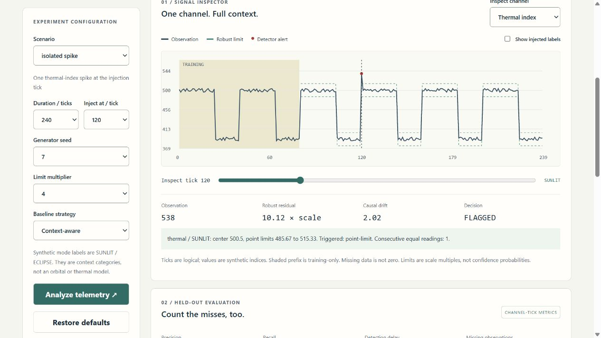

# Spacecraft Telemetry Anomaly Studio

[](https://github.com/JasonStys/spacecraft-telemetry-anomaly-studio/actions/workflows/validate.yml)
[](https://github.com/JasonStys/spacecraft-telemetry-anomaly-studio/actions/workflows/codeql.yml)

**Separate signal from surprise.** An explainable, offline-first telemetry analysis application by [Jason Stys](https://github.com/JasonStys).

Fit robust limits on the past, score later observations causally, and inspect every flag. Compare a context-aware baseline with a pooled baseline on the same held-out observations. See false positives, misses, detection delay and missing data—not an inflated single accuracy number.

This is a teaching/portfolio application using invented telemetry indices and logical ticks. It is **not an operational spacecraft monitor, flight-qualified system, physical model, command interface or failure diagnosis tool**. It uses statistical learning and explicit heuristics, not a neural network or an external AI service. No agency endorsement is implied.



## Features

- Eight reproducible fixtures: nominal, isolated spike, multichannel burst, slow drift, stuck sensor, full telemetry gap, partial dropout and step shift.
- Three synthetic channels and two characterized context categories; frozen training prefix at ticks 0–79, held-out evaluation from tick 80 onward.
- Channel/context median–MAD point limits, causal EWMA drift and a six-repeat flatline rule. Every flag has a residual, limit and reason.
- Honest quality handling: absent values break chart paths, reset temporal state and are excluded from sensor confusion counts; missing does not mean healthy.
- Ground-truth labels are separated from the detector and used only after scoring for evaluation. Undefined denominators stay undefined.
- Interactive responsive browser inspector, channel/tick selection, label overlay, alert/gap ledger and alternate-strategy comparison.
- JSON, evidence CSV, inert HTML and import-schema CSV downloads; deterministic content hashes and reproducible benchmark reports.
- Strict **CLI-only** local CSV import; no browser uploads, remote ingestion, arbitrary models, scripts or spacecraft connections.
- Optional immutable SQLite history, unsigned portable desktop bundles, tests and pinned GitHub Actions with no artifact/cache uploads.

## Try the app

Download the matching Windows/Linux/macOS ZIP from [Releases](https://github.com/JasonStys/spacecraft-telemetry-anomaly-studio/releases), verify its SHA-256, extract the **whole folder**, and launch `TelemetryAnomalyStudio` (`.exe` on Windows). It opens the local browser UI without requiring Python, Node, an account, cloud access or administrator rights. Ctrl+C stops the console service. Builds are unsigned; do not disable OS protections. Desktop bundles target their tested runner OS/architecture, not every historical OS. Mobile browser layout is tested; no phone-native executable is supplied.

For development: Python 3.12–3.14 and Node 24. Runtime analysis and serving use Python's standard library only.

```powershell
python -m venv .venv
.venv/Scripts/python -m pip install --require-hashes -r requirements-dev.lock
npm ci
npm run build
.venv/Scripts/python -m telemetry serve
```

On Linux/macOS use `.venv/bin/python`. The service binds only `127.0.0.1` on an ephemeral port. It is not a public Internet server.

```powershell
.venv/Scripts/python -m telemetry export --scenario slow-drift --output evidence.json --history local-runs.sqlite3
.venv/Scripts/python -m telemetry export --input examples/slow-drift.csv --output imported-report.html --format html
```

Imported accuracy metrics remain undefined because imports have no truth labels. Only numeric observations and characterized modes are accepted; the path is not included in reports. Exports never overwrite existing files. History is opt-in and capped at 100 immutable records.

## Repository structure

| Path                                    | Responsibility                                                                                                      |
| --------------------------------------- | ------------------------------------------------------------------------------------------------------------------- |
| `telemetry/detector.py`                 | Frame schema, robust training, frozen bands and causal point/drift/flatline decisions                               |
| `telemetry/engine.py`                   | Deterministic generator, label isolation, evaluation, strict CSV parser, caching and evidence hashes                |
| `telemetry/reports.py`                  | Structured/inert reports, import-schema CSV and parameterized immutable history                                     |
| `telemetry/server.py`                   | Loopback-only read-only API, origin/Host controls and confined built assets                                         |
| `telemetry/__main__.py` / `launcher.py` | Source/frozen app launch and local export/import CLI                                                                |
| `telemetry/resources/history.sql`       | SQLite records, constraints and immutable triggers                                                                  |
| `web/`                                  | TypeScript inspector, safe display transforms, accessible HTML/CSS and unit contracts                               |
| `tests/`                                | Independent statistic/rule oracles, full configuration grid, causality, parser fuzz, HTTP/CLI/SQL and browser tests |
| `tools/`                                | Benchmark verification, source/file inventory, frozen packaging and guarded draft release                           |
| `examples/`                             | Clearly synthetic strict-schema CSV for local import testing                                                        |
| `docs/`                                 | Model contracts, guides, ADRs, security, validation evidence, benchmark reports and screenshots                     |
| `.github/workflows/`                    | Cross-platform validation, CodeQL and draft-only release builds                                                     |

The [file catalog](docs/FILE_CATALOG.md) summarizes every file. Source headers describe responsibilities/functions/variables; the generated [exact-line code index](docs/CODE_INDEX.md) supplies current function and variable locations. CI rejects stale indexes rather than relying on manually duplicated line numbers.

## Verification

```powershell
.venv/Scripts/python -m ruff check telemetry tests tools launcher.py
.venv/Scripts/python -m ruff format --check telemetry tests tools launcher.py
.venv/Scripts/python -m mypy telemetry
.venv/Scripts/python -m pytest --cov=telemetry --cov-report=term-missing
.venv/Scripts/python tools/benchmark.py
.venv/Scripts/python tools/verify_repo.py
npm run format:check
npm test
npm run build
npx playwright install chromium firefox webkit
npm run test:e2e
```

See [validation](docs/VALIDATION.md) for observed results, not certification claims. Python tests require at least 90% branch-aware runtime coverage. CI runs on Linux/Python 3.12 and 3.14, Windows/macOS 3.14; browser checks run Chromium/Firefox/WebKit against actual production assets. Real frozen apps are exercised on all three desktop platforms. CodeQL and dependency audits supplement tests; green checks do not prove absence of defects or real-mission suitability.

## Documentation and support

[User guide](docs/USER_GUIDE.md) · [Detector/model contract](docs/MODEL.md) · [Architecture/ADRs](docs/ARCHITECTURE.md) · [API/CSV](docs/API.md) · [Security](docs/SECURITY.md) · [Validation](docs/VALIDATION.md) · [Release/rollback](docs/RELEASE.md) · [References/notices](docs/THIRD_PARTY.md).

Created and maintained by Jason Stys, MIT licensed. Open an issue with synthetic settings, the report ID and expected vs observed behavior; use the private reporting guidance for security concerns. Do not publish personal data, credentials or sensitive operational telemetry.
